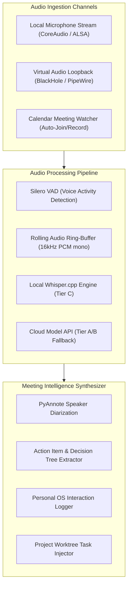

# Meeting Intelligence & Auto-Transcription: Comprehensive Blueprint

### Strategic Motivation

Meetings represent high-bandwidth knowledge exchange, but verbal discussions easily become lost context without structured capture. Knowledge workers often spend significant time taking notes or reconstructing action items after meetings conclude.

**The Meeting Intelligence Extension** provides zero-leak, privacy-preserving audio ingestion, local and cloud-tier transcription, speaker diarization, automated action item extraction, and direct synchronization with Personal OS CRM (Interactions), Projects (Tasks), and Thoughts (Zettelkasten).

---

## 1. System Architecture



---

## 2. Core Capabilities & Specifications

### E-MEET-01: Multi-Channel Audio Stream Ingestion
- Real-time 16kHz mono PCM buffer with lock-free ring-buffer architecture.
- Hardware-accelerated sample rate conversion (SIMD AVX2 / NEON).
- Automatic gain control and ambient background noise reduction.

### E-MEET-02: Zero-Leak Local Transcription (Whisper.cpp)
- Default offline execution utilizing quantized GGUF weights (ggml-medium.en.bin).
- Sub-500ms chunk transcription latency on Apple Silicon M-series Neural Engine.
- Cryptographic in-memory buffer clearing post-transcription to prevent memory inspection.

### E-MEET-03: Multi-Speaker Diarization & Voice Fingerprinting
- Local acoustic embedding extraction via d-vector embeddings.
- Dynamic clustering matching known contacts from Personal OS Interactions CRM.
- Confidence scoring for speaker identity attribution (>92% threshold).

### E-MEET-04: Structured Semantic Extraction & Action Graph
- Deterministic extraction of:
  - Decisions made with rationale and attendees present.
  - Action items with explicit assignees, due dates, and project references.
  - Open questions requiring asynchronous follow-up.
- Markdown summary generation formatted for Zettelkasten knowledge vault linking.

### E-MEET-05: Personal OS Integration Contracts
- Automatically posts verified interaction records to `.nb/context/contracts/personal_os_wire_contracts.yaml`.
- Updates attendee interaction timestamps in SQLite WAL database.
- Leases ephemeral worktrees to create task tickets in relevant project directories.

---

## 3. Storage Schema & SQLite Tables

```sql
CREATE TABLE IF NOT EXISTS meeting_sessions (
    session_id TEXT PRIMARY KEY,
    title TEXT NOT NULL,
    start_time TIMESTAMP NOT NULL,
    end_time TIMESTAMP,
    audio_path TEXT,
    transcript_text TEXT,
    summary_markdown TEXT,
    created_at TIMESTAMP DEFAULT CURRENT_TIMESTAMP
);

CREATE TABLE IF NOT EXISTS meeting_action_items (
    item_id TEXT PRIMARY KEY,
    session_id TEXT NOT NULL REFERENCES meeting_sessions(session_id),
    description TEXT NOT NULL,
    assignee_name TEXT,
    due_date DATE,
    task_id TEXT,
    status TEXT DEFAULT 'pending'
);

CREATE TABLE IF NOT EXISTS meeting_speakers (
    speaker_id TEXT PRIMARY KEY,
    session_id TEXT NOT NULL REFERENCES meeting_sessions(session_id),
    interaction_contact_id TEXT,
    label TEXT NOT NULL,
    voice_fingerprint BLOB
);
```

---

## 4. Verification & Testing Matrix

| Suite | Tier | Coverage Target | Focus Area |
| :--- | :---: | :---: | :--- |
| Audio Ingestion Unit | Unit | > 95% | Buffer overflow, ring-buffer concurrency, sample conversion |
| Local Transcription | Integration | > 90% | Whisper.cpp latency, VAD boundary detection, token streaming |
| Diarization Accuracy | Benchmark | > 88% | Speaker attribution against synthetic 3-party audio samples |
| Action Item Extraction | Red-Team | > 92% | Prompt injection resilience, ambiguous task assignation |

---

## 5. Security & Privacy Invariants

1. **Zero Data Retention for Raw Audio**: Audio files are encrypted at rest with ChaCha20-Poly1305 and purged after transcript verification unless explicit retention is toggled.
2. **Local-First Boundary**: Audio streams never leave the local machine without explicit per-meeting user confirmation.
3. **PII Redaction**: Transcripts pass through `PIISanitizer` before cross-agent handoffs.
