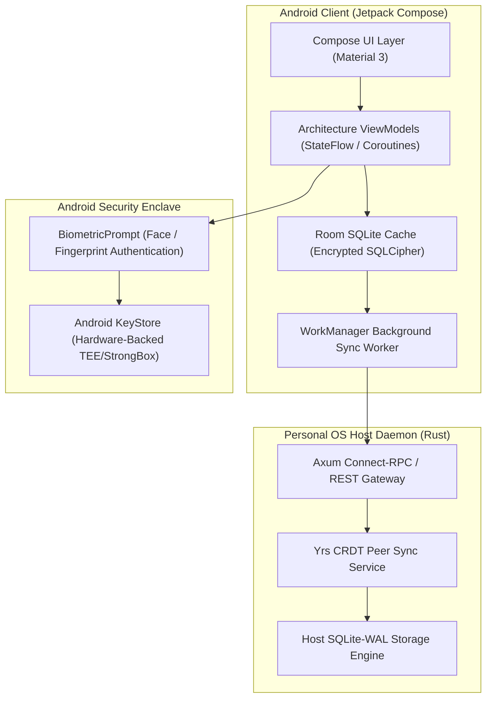
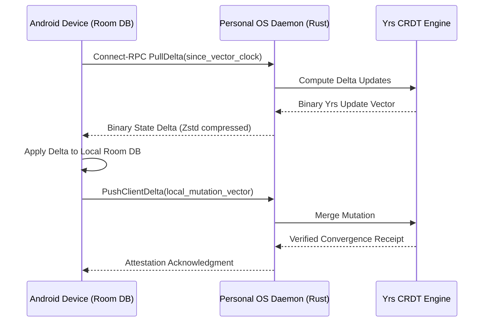

# Native Android Integration: Comprehensive Architectural Blueprint

### Strategic Motivation

Mobile ubiquity requires personal operating systems to maintain continuous availability and real-time synchronization on edge devices. Android provides a flexible, sandboxed platform for background synchronization, local SQLite persistence, biometric authentication, and quick task capture.

**The Native Android Extension** provides an offline-first Jetpack Compose application integrated with the Personal OS daemon via gRPC/Connect-RPC over WireGuard, WebSockets, and peer-to-peer CRDT state replication.

---

## 1. Architectural Topology

---

## 2. Detailed Technical Capabilities

### E-AND-01: Offline-First Jetpack Compose Architecture
- Declarative UI built with Jetpack Compose, Material 3 design system, and dynamic color theming.
- Uni-directional data flow (UDF) backed by Kotlin Coroutines and immutable `StateFlow` primitives.
- Dark mode, spatial edge-to-edge typography, and responsive folding display support.

### E-AND-02: Cryptographic SQLCipher Local Cache
- Full offline persistence of Thoughts, Tasks, and Contacts in local Room database.
- 256-bit AES encryption managed through Android KeyStore MasterKey.
- Zero plaintext database files in application storage sandbox.

### E-AND-03: WireGuard & Connect-RPC Transport
- Secure tunnel back to host machine via embedded WireGuard (wireguard-android) interface.
- Low-latency protobuf communication via Connect-RPC over HTTP/2.
- Binary WebSockets connection for instant real-time notifications and wake locks.

### E-AND-04: Background Synchronization via WorkManager
- Opportunistic periodic background sync constrained to Wi-Fi and unmetered networks.
- Exponential backoff with jitter on network dropouts.
- High-priority push message handling via Firebase Cloud Messaging (FCM) or local WebSockets.

### E-AND-05: Quick Capture Widgets & Native Share Targets
- Home screen quick capture widget for 1-tap thought and audio recording.
- Android system Share Target sheet ingestion (URLs, text clips, photos, PDF attachments).
- Wear OS companion application providing voice capture and glanceable daily brief widgets.

---

## 3. Data Sync Protocol & Conflict Resolution

---

## 4. Security & Compliance Invariants

1. **Hardware-Backed Key Storage**: Private keys and vault tokens are non-exportable and guarded by StrongBox or ARM TrustZone TEE.
2. **Biometric Re-Authentication**: Sensitive vault access requires fresh biometric authentication within a 60-second validity window.
3. **Strict App-Sandboxing**: No external storage permissions requested; zero shared world-readable files.
