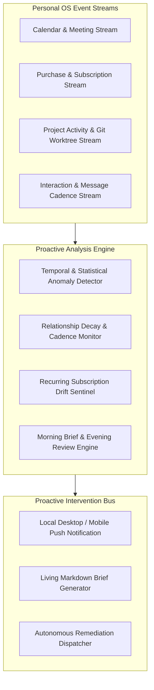

# Proactive Intelligence & Anomaly Detection: Deep Architectural Blueprint

### Strategic Motivation

Traditional personal software is purely reactive—waiting for the user to search, enter records, or query a chatbot. True executive support requires a proactive system that monitors state in the background, identifies temporal and financial anomalies, discovers neglected relationships, and synthesizes daily morning briefings without manual prompting.

**The Proactive Intelligence Extension** operates a lightweight, deterministic background daemon that processes event streams, computes statistical baselines, and issues low-friction, high-relevance proactive interventions.

---

## 1. System Architecture



---

## 2. Core Capabilities & Detailed Specifications

### E-PRO-01: Temporal Schedule Collision & Travel Buffer Sentinel
- Evaluates calendar schedules for back-to-back conflicting meetings across time zones.
- Automatically computes transit buffer requirements using geocoding and traffic models.
- Issues proactive warnings 90 minutes before impossible transition schedules.
- Analyzes historical meeting overruns to dynamically suggest 5-minute transition pauses.

### E-PRO-02: Relationship Decay & Cadence Guard
- Analyzes interaction history across key professional and personal contacts.
- Triggers gentle reminders when contact cadence drops below user-specified relationship targets (e.g., 30 days for mentors, 14 days for direct reports).
- Suggests contextual discussion topics derived from open project milestones and past meeting notes.
- Computes network centrality and closeness metrics to highlight key stakeholder relationships.

### E-PRO-03: Financial Subscription & Recurring Spend Drift Sentinel
- Analyzes double-entry purchase journals for unexpected price increases on SaaS subscriptions.
- Flags duplicate service subscriptions (e.g. overlapping AI compute subscriptions).
- Calculates 30-day burn rate projections and alerts when monthly discretionary spending accelerates >15% above 90-day moving average.
- Automatically categorizes recurring merchant charges against budget allocations.

### E-PRO-04: Autonomous Morning Brief Synthesis
- Generates a synthesized Markdown morning brief at 06:00 daily containing:
  - Critical calendar appointments and attendee background intelligence.
  - P0 project deliverables due within 48 hours.
  - Weather, transit recommendations, and proactive health reminders.
- Emits structured JSON summary to the Personal OS UI and native widgets.

### E-PRO-05: Evening Reflection & Daily Rollup Synthesizer
- Synthesizes end-of-day summary at 18:00 highlighting:
  - Completed project worktrees and git commits.
  - Logged thoughts and zettelkasten cross-links formed during the day.
  - Outstanding tasks requiring rescheduling or delegation.
- Prepares prioritized agenda drafts for the following morning.

---

## 3. Mathematical Foundations & Anomaly Scoring

Anomaly detection operates using rolling Z-score baselines combined with Exponentially Weighted Moving Averages (EWMA):

$$S_t = \alpha Y_t + (1 - \alpha) S_{t-1}$$
$$Z_t = \frac{Y_t - \mu_t}{\sigma_t}$$

Where:
- $\alpha \in [0.1, 0.3]$ is the exponential smoothing factor.
- $Y_t$ represents the observed event metric (spend amount, cadence delta, meeting buffer minutes).
- $\mu_t$ and $\sigma_t$ are rolling mean and standard deviation computed over a 90-day window.

An anomaly is declared when $|Z_t| \ge 2.5$ for three consecutive monitoring windows, triggering a prioritized intervention with low false-positive rates.

---

## 4. SQLite Schema & State Persistence

```sql
CREATE TABLE IF NOT EXISTS proactive_interventions (
    intervention_id TEXT PRIMARY KEY,
    category TEXT NOT NULL, -- 'schedule', 'relationship', 'finance', 'project'
    severity TEXT NOT NULL, -- 'info', 'warning', 'critical'
    title TEXT NOT NULL,
    description TEXT NOT NULL,
    entity_reference TEXT,
    z_score REAL,
    status TEXT DEFAULT 'pending', -- 'pending', 'dismissed', 'acted_upon'
    created_at TIMESTAMP DEFAULT CURRENT_TIMESTAMP,
    expires_at TIMESTAMP
);

CREATE TABLE IF NOT EXISTS contact_cadence_targets (
    contact_id TEXT PRIMARY KEY,
    target_days INTEGER NOT NULL,
    last_interaction_at TIMESTAMP,
    decay_score REAL DEFAULT 0.0,
    updated_at TIMESTAMP DEFAULT CURRENT_TIMESTAMP
);

CREATE TABLE IF NOT EXISTS recurring_subscription_audit (
    subscription_id TEXT PRIMARY KEY,
    merchant_name TEXT NOT NULL,
    expected_amount REAL NOT NULL,
    frequency TEXT NOT NULL, -- 'monthly', 'annual'
    last_billed_at DATE,
    last_amount REAL,
    drift_detected INTEGER DEFAULT 0
);
```

---

## 5. Verification & Testing Standards

| Suite | Tier | Coverage Target | Focus Area |
| :--- | :---: | :---: | :--- |
| EWMA Statistical Math | Unit | 100% | Edge variance, zero-deviation clamping, rolling windows |
| Schedule Conflict Engine | Integration | > 95% | Timezone transitions, overlapping buffers, travel latency |
| Subscription Drift Audit | Integration | > 90% | Currency conversion, split charges, annual renewals |
| Notification Throttle | Performance | 100% | Strictly capped at <= 3 push alerts / day |

---

## 6. Privacy & Execution Boundaries

1. **Deterministic Local Math**: Statistical anomaly computation executes 100% locally on-device without remote telemetry.
2. **Zero Involuntary Automation**: Interventions are strictly advisory; no automatic cancellations, deletions, or external messages are sent without human sign-off.
3. **Audited Expiration**: All pending interventions expire after 72 hours if unaddressed, preventing alert backlog accumulation.\n