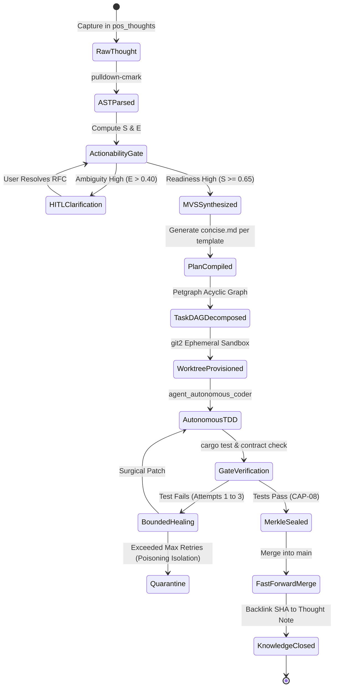

# Thought-to-Project Autonomous Plan Pipeline: Comprehensive Implementation Blueprint

### Executive Overview & Strategic Motivation
In modern engineering workflows, the bottleneck is rarely the initial conception of an idea, nor is it the execution of verified code in production. The primary friction point lies in the **translation phase**: converting an unstructured, informal thought into an implementable, test-driven software specification, breaking it down into actionable dependency graphs, establishing isolated Git branches, and configuring autonomous CI/CD gates.

The **Thought-to-Project Autonomous Plan Pipeline** bridges this chasm by establishing a zero-loss, cryptographically verifiable pipeline between **`pos_thoughts`** (Zettelkasten / CommonMark AST) and **`pos_projects`** (Git2 / Worktrees / Task DAG). Leveraging the **Percipience Context Engineering Framework**, thoughts are deterministically evaluated, normalized into Minimum Viable Set (MVS) specifications, compiled into standardized Layerable Domain Plans per [`custom_domain_layer_template.md`](../../templates/custom_domain_layer_template.md), and executed autonomously by the **Autonomous CI/CD Triad** (`.nb/core/autonomous_cicd.py`).

---

## 1. Mathematical Formulation & AST Extraction

### 1.1. CommonMark AST Traversal
Using `pulldown-cmark`, the engine parses raw thoughts into a structured AST:
- **Headings**: Extracted as high-level architectural domains or feature boundaries.
- **Code Blocks**: Extracted as target languages (e.g. ````rust`), type definitions, or API signatures.
- **Wikilinks**: Traversed as dependency pointers (`[[Concept A]]` indicates dependency or semantic relation).
- **Checklists**: Extracted as explicit user-specified deliverables.

### 1.2. Actionability Readiness Score ($S$)
Before promoting a thought into a software plan, the engine evaluates its implementation readiness:
$$S = \min\left(1.0, \; w_h \cdot H + w_c \cdot C + w_l \cdot L + w_t \cdot T\right)$$
Where:
- $H$: Heading hierarchy depth normalized ($0.0 \le H \le 1.0$).
- $C$: Presence of concrete code snippets or data schemas ($C \in \{0.0, 0.5, 1.0\}$).
- $L$: Connected wikilinks count normalized ($L = \min(1.0, \frac{\text{links}}{3})$).
- $T$: Technical noun density extracted via fast local POS tagging.
- Default weights: $w_h = 0.20, w_c = 0.35, w_l = 0.20, w_t = 0.25$.
- **Threshold**: If $S \ge 0.65$, the thought qualifies for autonomous plan compilation.

### 1.3. Ambiguity Entropy Formulation ($E$)
To prevent subagents from hallucinating undefined business logic, ambiguity entropy is computed:
$$E = -\sum_{i=1}^{N} p_i \log_2(p_i)$$
Where $p_i$ represents the uncertainty distribution across core architectural dimensions (Data Model, API Contract, Error Handling, Concurrency Model).
- If $E \le 0.40$: Autonomous derivation proceeds immediately.
- If $E > 0.40$: Autonomous execution pauses; a structured Clarification RFC is drafted in `user/hitl/clarification_rfcs/`.

---

## 2. Pipeline State Transitions & Rust Architecture



---

## 3. Database Schema Updates (`pos_storage`)

To track the lifecycle from thought to autonomous merge, the following relational tables are established in SQLite:

```sql
-- Pipeline Run Ledger
CREATE TABLE IF NOT EXISTS thought_project_pipelines (
    id TEXT PRIMARY KEY,
    thought_id TEXT NOT NULL REFERENCES thoughts(id),
    project_id TEXT NOT NULL REFERENCES projects(id),
    status TEXT NOT NULL CHECK (status IN ('evaluating', 'rfc_pending', 'plan_compiled', 'worktree_active', 'cicd_running', 'shipped', 'quarantined')),
    actionability_score REAL NOT NULL,
    ambiguity_entropy REAL NOT NULL,
    generated_plan_path TEXT,
    ephemeral_branch TEXT,
    worktree_path TEXT,
    target_commit_sha TEXT,
    merkle_block_id INTEGER,
    created_at DATETIME NOT NULL DEFAULT CURRENT_TIMESTAMP,
    updated_at DATETIME NOT NULL DEFAULT CURRENT_TIMESTAMP
);

-- Petgraph Task DAG Nodes
CREATE TABLE IF NOT EXISTS pipeline_task_nodes (
    id TEXT PRIMARY KEY,
    pipeline_id TEXT NOT NULL REFERENCES thought_project_pipelines(id) ON DELETE CASCADE,
    title TEXT NOT NULL,
    task_type TEXT NOT NULL CHECK (task_type IN ('wire_contract', 'test_scaffold', 'core_impl', 'integration_gate')),
    dependencies JSON NOT NULL DEFAULT '[]', -- Array of parent task UUIDs
    execution_status TEXT NOT NULL DEFAULT 'pending' CHECK (execution_status IN ('pending', 'running', 'completed', 'failed')),
    retry_count INTEGER NOT NULL DEFAULT 0,
    output_diff TEXT,
    created_at DATETIME NOT NULL DEFAULT CURRENT_TIMESTAMP
);
```

---

## 4. Git Worktree & CI/CD Triad Integration

### 4.1. Worktree Isolation Protocol
1. Subagent receives task DAG from `pos_projects`.
2. Invokes `git2::Repository::worktree()` to create `.nb/workspaces/subagent_<slug>_<timestamp>/` branching from `main`.
3. Sets up local environment and executes all file edits, formatting, and test suites exclusively in the sandboxed directory.
4. The user's active checkout on `main` is completely protected from uncommitted scratch diffs.

### 4.2. Autonomous CI/CD Triad Loop (`.nb/core/autonomous_cicd.py`)
- **Step 1 (Scaffolding)**: Generates wire contracts in `context/contracts/` and Serde DTOs in `shared/contracts/`.
- **Step 2 (TDD Scaffolding)**: Generates failing test suites matching requirements.
- **Step 3 (Implementation)**: Implements production logic in `workplace/modules/`.
- **Step 4 (Verification Gate)**: Runs `cargo test -p <module>`. If tests fail, `DiagnosticLogPruner` extracts AST error slices and reprompts `agent_autonomous_coder` with a hard ceiling of 3 retries.
- **Step 5 (Merkle Sealing)**: Computes SHA-256 hash of diff, appends transition block to `context_ledger.yaml`, and fast-forward merges the verified branch to `main`.
- **Step 6 (Knowledge Closure)**: Calls `pos_thoughts::update_note()` to append:
  ```markdown
  ---
  ## 🚀 Implementation Proof
  - **Status**: Shipped ✅
  - **Plan**: `.nb/plan/extensions/<slug>/concise.md`
  - **Git Commit**: `e8b27f4`
  - **Merkle Block**: Block #9 (`SHA-256: e8b2...014c`)
  ---
  ```

---

## 5. Detailed Wire Contract Specifications

The interaction between `pos_thoughts`, `pos_projects`, and the autonomous CI/CD triad is governed by `.nb/context/contracts/thought_to_project_wire_contracts.yaml`:

### 5.1. RPC Method: `evaluate_thought_readiness`
- **Endpoint**: `/api/v1/thought_to_project/evaluate`
- **Preconditions**: Thought must exist in `pos_storage` and have valid CommonMark syntax.
- **Input Parameters**:
  - `thought_id`: String (UUID format).
  - `content_markdown`: CommonMark raw note text (max 100 KB).
  - `user_context`: Evaluation threshold overrides (`min_actionability_threshold: 0.65`, `ambiguity_tolerance: 0.40`).
- **Output Schema**:
  - `actionability_score`: Float ($0.00 \le S \le 1.00$).
  - `ambiguity_score`: Float ($0.00 \le E \le 1.00$).
  - `readiness_status`: Enum (`ready`, `needs_clarification`, `too_vague`, `too_complex`).
  - `extracted_entities`: Headings, wikilinks, checklists, code blocks, and technical nouns.

### 5.2. RPC Method: `synthesize_mvs_spec`
- **Endpoint**: `/api/v1/thought_to_project/synthesize_mvs`
- **Input Parameters**:
  - `thought_id`: String (UUID).
  - `extracted_entities`: Object output from `evaluate_thought_readiness`.
  - `domain_hint`: Target domain module slug.
- **Output Schema**:
  - `mvs_spec_path`: Absolute path in `user/inputs/` (e.g. `user/inputs/thought_123_mvs.yaml`).
  - `requirements_list`: Array of functional criteria and non-negotiable invariants.
  - `scope_boundary`: Strict in-scope deliverables and explicitly excluded tasks.

### 5.3. RPC Method: `compile_domain_plan`
- **Endpoint**: `/api/v1/thought_to_project/compile_plan`
- **Input Parameters**:
  - `thought_id`: String (UUID).
  - `mvs_spec_path`: Path to verified MVS specification.
  - `template_type`: Standard `custom_domain_layer_template.md`.
- **Output Schema**:
  - `plan_path`: Output path in `.nb/plan/extensions/<slug>/concise.md`.
  - `task_count`: Total tasks decomposed in Petgraph DAG.
  - `ephemeral_branch`: Isolated git branch name (`feat/thought_<slug>`).

### 5.4. RPC Method: `close_knowledge_loop`
- **Endpoint**: `/api/v1/thought_to_project/close_loop`
- **Input Parameters**:
  - `thought_id`: String (UUID).
  - `commit_hash`: Verified 40-character SHA-1/SHA-256 commit hash.
  - `merkle_block_id`: Monotonically increasing Merkle block index.
  - `status`: Enum (`shipped`, `failed`, `quarantined`).
- **Postconditions**: Notes in `pos_thoughts` are backlinked with commit proofs, Merkle hashes, and sealed receipts.

---

## 6. Specialist Subagent Specifications & Metaprompts

### 6.1. `agent_thought_synthesizer` (Tier B/A)
- **Role**: AST Analysis & Technical Extraction Specialist.
- **Model Tier**: Fast local parsing / high-throughput model (`claude-3-5-haiku`, `gemini-2.0-flash`).
- **Core Directives**:
  1. Parse input Markdown notes with `pulldown-cmark`.
  2. Extract concrete domain entities, wikilinks, code blocks, and check-list items.
  3. Calculate Actionability Readiness Score ($S$) and Ambiguity Entropy ($E$).
  4. Emit structured clarification RFCs if $E > 0.40$; never hallucinate unspecified technical assumptions.

### 6.2. `agent_plan_architect` (Tier A)
- **Role**: Domain Specification & Petgraph Task DAG Compiler.
- **Model Tier**: High-reasoning frontier model (`claude-3-7-sonnet`, `gemini-2.0-pro`).
- **Core Directives**:
  1. Transform normalized MVS specs into Layerable Domain Plans adhering to `custom_domain_layer_template.md`.
  2. Deconstruct requirements into an acyclic directed graph (`petgraph::Graph`) with clear dependency barriers.
  3. Formulate wire contracts in Serde DTO format with strict schema validation.
  4. Provision isolated ephemeral git worktrees via `git2` without modifying active checkout.

### 6.3. `agent_autonomous_coder` (Tier B/A)
- **Role**: Test-Driven Development & Self-Healing Implementation Agent.
- **Model Tier**: Code-optimized reasoning model with bounded retries.
- **Core Directives**:
  1. Generate red failing tests before writing production implementation.
  2. Implement minimal necessary code in target Cargo crate to turn tests green.
  3. If compilation or tests fail, invoke `DiagnosticLogPruner` and apply targeted surgical diffs ($\le 3$ retries).
  4. If retries expire, halt immediately, quarantine failing diffs to `user/hitl/poisoning_quarantine.md`, and release worktree lease.

---

## 7. Delivery Workflow DAG & Execution Lifecycle Hooks

```mermaid
flowchart TD
    subgraph Phase_1_Extraction["Phase 1: Ingestion & Readiness"]
        T1["Capture Thought Note"] --> T2["AST Parsing (pulldown-cmark)"]
        T2 --> T3["Compute Readiness S & Entropy E"]
        T3 -->|E > 0.40| T_HITL["Draft Clarification RFC (user/hitl/)"]
        T_HITL -->|User Approves| T4["Synthesize MVS Spec"]
        T3 -->|E <= 0.40 & S >= 0.65| T4
    end

    subgraph Phase_2_Compilation["Phase 2: Plan & DAG Compilation"]
        T4 --> C1["Compile Domain Plan (concise.md)"]
        C1 --> C2["Decompose Petgraph Task DAG"]
        C2 --> C3["Verify Cycle Freedom (Topological Sort)"]
    end

    subgraph Phase_3_Execution["Phase 3: Autonomous CI/CD Sandbox"]
        C3 --> S1["Provision Ephemeral Worktree"]
        S1 --> S2["Generate Failing TDD Scaffolding"]
        S2 --> S3["Synthesize Production Logic"]
        S3 --> S4["Run Verification: cargo test -p <module>"]
        S4 -->|Tests Fail (Retry <= 3)| S5["Diagnostic AST Slicing & Surgical Repair"]
        S5 --> S3
        S4 -->|Tests Fail (Retry > 3)| S_QUAR["Quarantine Diff & Poisoning Alert"]
        S4 -->|Tests Pass| S6["7-Stage Gatekeeper Verification"]
    end

    subgraph Phase_4_Closure["Phase 4: Merkle Sealing & Backlinking"]
        S6 --> M1["Seal Block in context_ledger.yaml"]
        M1 --> M2["Fast-Forward Merge to main"]
        M2 --> M3["Reclaim Worktree Lease"]
        M3 --> M4["Backlink SHA Proof to Thought Note"]
    end
```

### 7.1. Re-Entrant Lifecycle Hook Bindings
- **`pre_spawn`**: `percipience worktree lease --module domain_thought_to_project` allocates isolated directory.
- **`pre_execution`**: `percipience check --ast-prune --schema-lint` validates contracts and manifests.
- **`in_flight`**: Prompt injection and path traversal guards intercept out-of-boundary access.
- **`handover`**: `percipience handoff issue --from agent_thought_to_project_architect --to agent_qa_sentinel`.
- **`pre_merge_gate`**: `./percipience gate` validates 7 immutable pre-merge gatekeeper stages.
- **`self_healing`**: `percipience heal --max-attempts 3` manages bounded repair cycles.
- **`post_merge_seal`**: `./percipience merkle seal --worm-egress` anchors block into ledger.

---

## 8. Zero-Trust Security Mesh & Sandbox Boundaries

1. **Path Traversal Clamping**: Subagents executing inside ephemeral worktrees are restricted strictly to `.nb/workspaces/subagent_<slug>/`. Any attempt to read or write files outside designated boundary triggers security tripwires.
2. **Network Isolation**: The TDD sandbox executes in an offline enclave; outbound HTTP/TCP calls are blocked unless explicitly permitted by zero-trust security mesh policies.
3. **Secret Redaction**: All note excerpts and generated source files are processed by `PIISanitizer` to eliminate API tokens, private keys, and confidential user data before Merkle anchoring.
4. **WORM Non-Repudiation**: Verification receipts are committed to immutable Write-Once-Read-Many storage blocks in `.nb/workspaces/worm_vault/`.

---

## 9. 4-Pillar Error Taxonomy & Adaptive Recovery Playbooks

| Pillar | Error Class | Root Cause | Adaptive Recovery Playbook |
| :--- | :--- | :--- | :--- |
| **Pillar 1** | `TRANSIENT` | File lock timeout, temporary IO contention | Exponential backoff jitter ($\le 3$ attempts, initial delay 250ms). |
| **Pillar 2** | `STRUCTURAL` | Rust compiler syntax error, missing Serde derive | AST diagnostic extraction, reprompt coder agent with precise compiler error slice. |
| **Pillar 3** | `INVARIANT` | DAG cycle detected, worktree boundary violation | Abort execution wave, purge invalid edge, recompute topological order. |
| **Pillar 4** | `HALLUCINATORY` | Hallucinated external dependency, scope drift | Terminate coder subagent, rollback worktree to clean commit, quarantine failure to `user/hitl/`. |

---

## 10. Quantitative GenAI Evaluation Metrics

```
Parity Score = 0.20 * AST + 0.25 * Contract + 0.20 * Behavior + 0.15 * Handover + 0.10 * Doc + 0.10 * SupplyChain
```
- **AST Parity** ($\ge 0.95$): Exact structural correspondence between thought headings and generated task DAG nodes.
- **Contract Parity** ($\ge 0.98$): 100% adherence to schemas defined in `thought_to_project_wire_contracts.yaml`.
- **Behavior Parity** ($\ge 0.95$): Passing all unit and integration test assertions in `pos_thoughts` and `pos_orchestrator`.
- **Handover Parity** ($\ge 0.98$): Valid cryptographic HMAC-SHA256 tokens linking subagent transitions.
- **Line Ratio Invariant**: $N(\text{concise}) < N(\text{detailed})$ strictly maintained for token budget optimization.

---

## 11. Verification & Testing Strategy

```bash
# 1. Unit test CommonMark AST extraction and readiness scoring
cargo test -p pos_thoughts --test readiness_score_test

# 2. Test Petgraph dependency DAG topological sorting and cycle detection
cargo test -p pos_thoughts --test task_dag

# 3. Test git2 worktree isolation and atomic merge
cargo test -p pos_core --test core_tests

# 4. Test end-to-end thought-to-project pipeline flow
cargo test -p pos_thoughts --test integration_tests

# 5. Run 7-stage pre-merge gatekeeper and dynamic parity recalculation
./percipience gate
./percipience parity recalculate --plan-dir .nb/plan/extensions/thought_to_project
```
