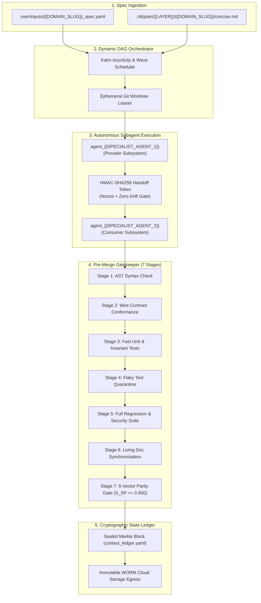

# Standard Template Suite for Percipience Canonical Domain Plans (v3.0)

> **Target Directory**: [`.nb/plan/templates/`](file:///Users/lakhwinder/PycharmProjects/nb_fairyfly/.nb/plan/templates/)  
> **Reference Schema**: [`.nb/plan/MANIFEST_SCHEMA.json`](file:///Users/lakhwinder/PycharmProjects/nb_fairyfly/.nb/plan/MANIFEST_SCHEMA.json)  
> **Parity Audit Checklist**: [`.nb/plan/PARITY_AUDIT_CHECKLIST.md`](file:///Users/lakhwinder/PycharmProjects/nb_fairyfly/.nb/plan/PARITY_AUDIT_CHECKLIST.md)  
> **Automated Validation Suite**: [`bash .nb/plan/scripts/validate.sh`](file:///Users/lakhwinder/PycharmProjects/nb_fairyfly/.nb/plan/scripts/validate.sh)  
> **Sync Utility**: [`python3 .nb/plan/scripts/sync_plan_versions.py`](file:///Users/lakhwinder/PycharmProjects/nb_fairyfly/.nb/plan/scripts/sync_plan_versions.py)

---

## 1. Overview & Architecture Standards

The **Percipience Context Engineering Framework** governs workspace orchestration, contract validation, and multi-agent execution across an active 3-tier hierarchy:
1. **Master Architecture Plans** (`.nb/plan/master/`): Generic governance—poly-module lifecycles, cryptographic Merkle ledgers, AST token compression, security mesh, enterprise UI design systems, and sequential pipeline orchestration.
2. **Layerable Domain Plans** (`.nb/plan/l1/`): Modular capabilities—SaaS portal, VSCode extension, IntelliJ/PyCharm plugin, npx installer, and tiered wheel packaging.
3. **Verification & Test Plans** (`.nb/plan/test/`): Automated end-to-end regression harnesses, multi-tier execution, and vulnerability red-team suites.

This directory provides the **Canonical 4-File Template Suite** conforming to **Manifest Schema v3.0**, enabling rapid scaffolding of production-ready, acyclic, and cryptographically verified plans that run autonomously.

---

## 2. Standard 4-File Plan Pattern

Every domain plan directory must contain exactly four standardized, synchronized files:

```
.nb/plan/<layer_level>/<domain-slug>/
├── README.md        # Human-readable navigation, capability summary & autonomous execution guide
├── MANIFEST.yaml    # Canonical v3.0 metadata, maturity, semantic parity, DAG dependencies & SHA-256 hashes
├── concise.md       # Compact domain specification for token-optimized agentic context (~140-190 lines)
└── detailed.md      # Comprehensive engineering blueprint, wire contracts, lifecycle hooks & test harness (~500-650 lines)
```

### Core Invariants & File Responsibilities

| File | Primary Consumer | Target Line Count | Invariant Rules & Responsibilities |
| :--- | :--- | :---: | :--- |
| **`MANIFEST.yaml`** | Plan Gatekeeper & CI/CD | 75–120 lines | Strictly adheres to [`MANIFEST_SCHEMA.json`](file:///Users/lakhwinder/PycharmProjects/nb_fairyfly/.nb/plan/MANIFEST_SCHEMA.json). Contains `maturity`, `semantic_parity` (6 vectors), acyclic `dependencies`, `autonomous_execution`, `lifecycle_hooks`, and SHA-256 content hashes. |
| **`README.md`** | Human Engineers & Audits | 150–250 lines | High-level architectural overview, capability bullet points, hook lifecycle documentation, handover protocols, and execution prerequisites. |
| **`concise.md`** | Agent Prompt Context | 140–190 lines | Compact domain specification saving 60–80% tokens: YAML frontmatter, executive grounding, Mermaid pipeline DAG, quad-space layout, dynamic tier matrix, lifecycle hooks, and CLI commands. |
| **`detailed.md`** | Deep Planning & Verification | 500–650 lines | Complete implementation guide: Full wire contract schemas, visual pipeline DAG & stage contract inspection drawer specs, specialist subagents, cryptographic handovers, security mesh, and 100% test harness. |

> [!IMPORTANT]
> **Line Count Invariant**: `N_lines(concise.md) < N_lines(detailed.md)` is strictly enforced across all plan validation gates.

---

## 3. Autonomous Execution & Verification Architecture

Plans generated from these templates are engineered for **zero-human autonomous execution** by AI coding agents and the Percipience orchestrator:



### 3.1. Re-Entrant Lifecycle Hooks
Autonomous agents execute against standardized hooks:
- **`PreSpawnHook`**: Leases isolated ephemeral Git worktree and validates Capability-Based Access Control (CBAC) token.
- **`PreExecutionHook`**: Ingests AST-pruned context ($\ge 60\%$ token compression) and validates contract schemas.
- **`InFlightGuardrail`**: Scans diffs and prompts in real time for prompt injection, secret leaks, and unvetted dependencies.
- **`HandoverHook`**: Synthesizes cryptographically signed `HandoffToken` with single-use nonce, artifact hash, and parity proof.
- **`PreMergeGateHook`**: Runs the 7-Stage Pre-Merge Gatekeeper (`./percipience gate`).
- **`PostFailureHook`**: Triggers bounded 3-step diagnostic self-healing loop via `crates/percipience-core/src/diagnostic.rs`.
- **`PostMergeSealHook`**: Seals cryptographic Merkle block and triggers immutable WORM egress.

### 3.2. Cryptographic Handover Protocol
Cross-agent transitions must carry a valid `HandoffToken`:
$$\text{Token} = \text{HMAC-SHA256}(K_{\text{platform}}, \text{WorkflowID} : \text{Stage} : \text{GateID} : \text{FromAgent} \to \text{ToAgent} : \text{ArtifactHash} : \text{ParityHash} : \text{Nonce})$$
- **Guaranteed Delivery**: Outbox spool (`.nb/context/handoffs/outbox/`) $\to$ Inbox spool (`.nb/context/handoffs/inbox/<recipient>/`).
- **Anti-Replay Defense**: Tokens spent in nonces cache or age $> 300\text{s}$ rejected with `REJECTED_REPLAYED_HANDOFF_TOKEN`.
- **Anti-Drift Gating**: Blocked if semantic parity $S_{SP} < 0.950$.

---

## 4. Robust Specification (Spec) Standards

Every generated plan must provide:
1. **Formal Wire Contracts**: Complete JSON Schema / YAML definitions with strict typing, UUID message headers, and security signatures.
2. **Architectural Safety Invariants**: Markdown rules establishing non-negotiable threading, memory, and security constraints.
3. **Interactive Contract Drawer Integration**: Stage-to-contract mappings with pre/postconditions, mock payloads, and duration telemetry.
4. **Quad-Space Mapping**: Complete file inventory across `.nb/`, `workplace/`, `user/`, and ephemeral worktrees.

---

## 5. Template Placeholder Catalog

When scaffolding a new plan from this directory, substitute the following variables:

| Placeholder Variable | Description | Canonical Example |
| :--- | :--- | :--- |
| `{{DOMAIN_SLUG}}` | Lowercase snake_case identifier | `cloud_provisioner` |
| `{{DOMAIN_NAME}}` | Human-readable domain title | `Cloud Infrastructure Provisioner` |
| `{{LAYER}}` | Target hierarchy layer | `master` or `l1` |
| `{{CAPABILITY_RATING}}` | Maturity rating badge | `TIER_L1` or `MASTER` |
| `{{PARENT_PLAN}}` | Relative path to parent plan | `master/parent-master-plan/concise.md` |
| `{{CURRENT_DATE}}` | ISO date string | `2026-11-18` |
| `{{DOMAIN_CAPABILITY_1..4}}` | Core domain pillars | `Hermetic Multi-Region Resource Orchestration` |
| `{{DOMAIN_WIRE_CONTRACT_1..2}}` | Wire contract filenames | `resource_provisioning_contract.yaml` |
| `{{DOMAIN_INVARIANT_RULE_1..2}}` | Safety rule filenames | `cross_region_isolation_invariants.md` |
| `{{SPECIALIST_AGENT_1..2}}` | Subagent manifest identifiers | `agent_infra_provisioning_specialist` |
| `{{DELIVERY_WORKFLOW}}` | Pipeline workflow manifest ID | `infra_delivery_flow.yaml` |
| `{{MODULE_PROVIDER}}` | Provider implementation module | `mod_infra_engine` |
| `{{MODULE_CONSUMER}}` | Consumer implementation module | `mod_infra_client` |

---

## 6. Scaffolding & Verification Workflow

Follow this step-by-step procedure to create, populate, and certify a new plan:

### Step 1: Create Plan Directory
```bash
# Example: Creating an L1 domain plan
mkdir -p .nb/plan/l1/my-new-domain
```

### Step 2: Copy Canonical Template Files
```bash
cp .nb/plan/templates/MANIFEST.yaml .nb/plan/l1/my-new-domain/
cp .nb/plan/templates/README.md .nb/plan/l1/my-new-domain/
cp .nb/plan/templates/concise.md .nb/plan/l1/my-new-domain/
cp .nb/plan/templates/detailed.md .nb/plan/l1/my-new-domain/
```

### Step 3: Populate Domain Placeholders
Replace all `{{...}}` tags across all four files with your domain-specific architectural specifications.

### Step 4: Synchronize Line Counts & Cryptographic Hashes
```bash
python3 .nb/plan/scripts/sync_plan_versions.py
```
This computes and records exact SHA-256 hashes and line counts into `MANIFEST.yaml`.

### Step 5: Execute Automated Plan Integrity Gates
```bash
bash .nb/plan/scripts/validate.sh
```
This validates:
- Schema v3.0 compliance via [`MANIFEST_SCHEMA.json`](file:///Users/lakhwinder/PycharmProjects/nb_fairyfly/.nb/plan/MANIFEST_SCHEMA.json).
- Dependency DAG cycle freedom and topological ordering.
- 100% cryptographic SHA-256 hash matching.
- Automatic regeneration of [`CAPABILITY_MATRIX.md`](file:///Users/lakhwinder/PycharmProjects/nb_fairyfly/.nb/plan/CAPABILITY_MATRIX.md).

### Step 6: Verify Regression Test Suite
```bash
cargo test --workspace
```
Ensure 100% test pass rate across all workplace unit, integration, and security tests.
