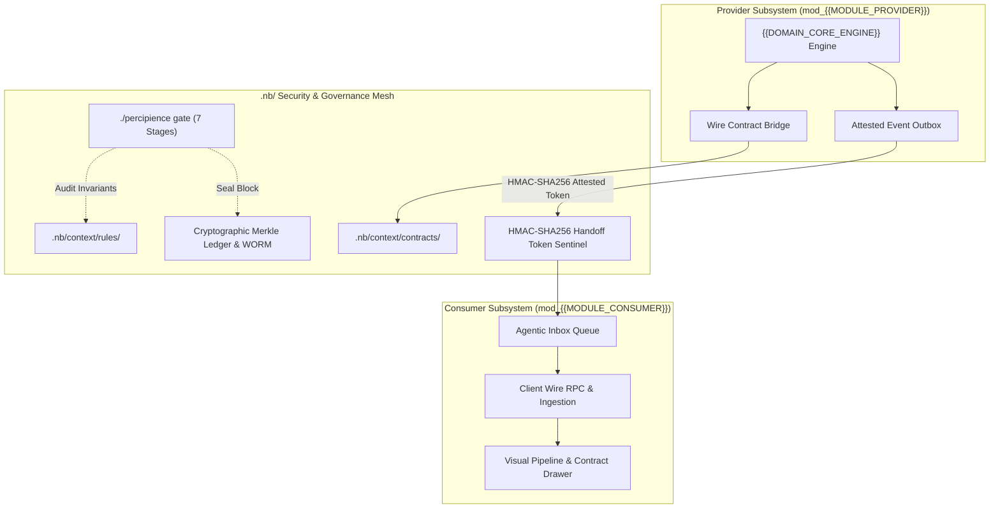

# Layerable Context Engineering Plan: {{DOMAIN_NAME}} (Concise Specification)

### Executive Overview & Domain Grounding

This document is the **Canonical Concise Plan Specification** for **{{DOMAIN_NAME}}**, designed to overlay onto the **Parent Master Framework** (`.nb/plan/master/parent-master-plan/concise.md`). It provides a token-optimized representation ($60\text{--}80\%$ token reduction) for autonomous AI agent context injection, defining core capabilities, wire contracts, visual pipeline stages, lifecycle hooks, and cryptographic handovers:

1. **{{DOMAIN_CAPABILITY_1}}**: Runtime architecture, communication protocols, and execution interfaces.
2. **{{DOMAIN_CAPABILITY_2}}**: Domain state models, transactional boundaries, and idempotency guarantees.
3. **{{DOMAIN_CAPABILITY_3}}**: Non-negotiable architectural invariants, security rules, and latency/memory budgets.
4. **{{DOMAIN_CAPABILITY_4}}**: Automated verification harness, visual pipeline DAG, and mock simulation loopback.



---

## 1. Autonomous Execution Directive & Swarm Authority

Autonomous agents executing this plan must operate under the 4-tier Percipience authority hierarchy:
`ORCHESTRATOR` > `DOMAIN_ARCHITECT` > `SPECIALIST_WORKER` > `GATEKEEPER_SENTINEL`

- **Execution Engine**: `DynamicDAGOrchestrator` resolves dependencies via Kahn topological sort.
- **Hermetic Worktrees**: Each specialist subagent leases an isolated ephemeral Git worktree (`wt_mod_{{MODULE_PROVIDER}}`, `wt_mod_{{MODULE_CONSUMER}}`). Plaintext code modifications in dirty parent workspaces are blocked.
- **Autonomous Step Execution**: Each task proceeds through:
  `Lease Worktree` $\to$ `Inject AST Pruned Context` $\to$ `Author Code & Tests` $\to$ `Self-Validate Invariants` $\to$ `Issue Signed HandoffToken` $\to$ `Consolidate via Gatekeeper`.

---

## 2. Visual Pipeline DAG & Handled Stage Contracts

The domain workflow executes as an acyclic DAG visible across IntelliJ/PyCharm, VSCode, and SaaS Portal surfaces. Each stage enforces explicit handled contracts viewable via the interactive inspection drawer:

| Stage ID | Stage Name | Assigned Executor | Handled Contract | Inputs / Outputs | Preconditions & Postconditions |
| :--- | :--- | :--- | :--- | :--- | :--- |
| `stage_validate_contracts` | Schema & Rule Sentinel | `agent_contract_sentinel` | `{{DOMAIN_WIRE_CONTRACT_1}}.yaml` | In: Raw Spec / Out: Validation Receipt | Pre: Contracts exist; Post: Strict schema lint passes |
| `stage_build_provider` | Compile & Verify Provider | `agent_{{SPECIALIST_AGENT_1}}` | `{{DOMAIN_WIRE_CONTRACT_2}}.json` | In: Domain Spec / Out: Provider Artifact | Pre: Worktree leased; Post: Unit tests 100% pass |
| `stage_verify_consumer` | Consumer Loopback Test | `agent_{{SPECIALIST_AGENT_2}}` | `{{DOMAIN_WIRE_CONTRACT_1}}.yaml` | In: Provider Artifact / Out: Test Evidence | Pre: Mock server active; Post: Loopback 0 drift |
| `stage_security_seal` | Security Mesh Gatekeeper | `platform.gatekeeper` | `handoff_token_attestation` | In: Test Evidence / Out: Signed Merkle Block | Pre: All stages pass; Post: Merkle block sealed ($S_{SP} \ge 0.95$) |

---

## 3. Quad-Space Clean Boundary Mapping

- **Governance & Context (`.nb/`)**:
  - Wire Contracts: `.nb/context/contracts/{{DOMAIN_WIRE_CONTRACT_1}}.yaml`, `{{DOMAIN_WIRE_CONTRACT_2}}.json`
  - Invariant Rules: `.nb/context/rules/{{DOMAIN_INVARIANT_RULE_1}}.md`, `{{DOMAIN_INVARIANT_RULE_2}}.md`
  - Specialist Agents: `.nb/agentic/custom/agents/agent_{{SPECIALIST_AGENT_1}}.yaml`, `agent_{{SPECIALIST_AGENT_2}}.yaml`
  - Pipeline Workflows: `.nb/agentic/custom/workflows/{{DELIVERY_WORKFLOW}}.yaml`
- **Implementation Space (`workplace/`)**:
  - Core Modules: `workplace/modules/mod_{{MODULE_PROVIDER}}/`, `workplace/modules/mod_{{MODULE_CONSUMER}}/`
  - Integration Tests: `workplace/tests/test_{{DOMAIN_SLUG}}_space.py` (100% contract coverage)
- **User Layer (`user/`)**:
  - Sparse Initial Requirements: `user/inputs/{{DOMAIN_SLUG}}_spec.yaml`
  - Execution Receipts: `user/outputs/{{DOMAIN_SLUG}}_verification_receipt.json`
  - HITL Quarantine: `user/hitl/poisoning_quarantine.md` (surgical rollback audit ledger)
- **Ephemeral Worktrees**: Ephemeral directories provisioned in RAM (`tmpfs` / `.scratch/test_worktrees/`) with automatic cleanup.

---

## 4. Re-Entrant Autonomous Lifecycle Hooks

Autonomous execution is governed by standard re-entrant lifecycle hooks:

```
[PreSpawnHook]      -> Leases isolated Git worktree & validates CBAC capability tokens.
[PreExecutionHook]  -> Ingests AST-pruned context (<= 65% token savings) & verifies contract schemas.
[InFlightGuardrail] -> Intercepts prompt injections, secret leaks, and unvetted dependencies.
[HandoverHook]      -> Issues cryptographic HMAC-SHA256 HandoffToken bound to artifact & parity hash.
[PreMergeGateHook]  -> Executes 7-Stage Pre-Merge Gatekeeper (./percipience gate).
[PostFailureHook]   -> Initiates bounded 3-step diagnostic self-healing (crates/percipience-core/src/diagnostic.rs).
[PostMergeSealHook] -> Seals SHA-256 Merkle block and triggers immutable WORM cloud egress.
```

---

## 5. Cryptographic Inter-Agent Handover Protocol

Transitions between subagents require cryptographically attested `HandoffToken` payloads:

```
Token = HMAC-SHA256(Secret, WorkflowID : Stage : GateID : FromAgent -> ToAgent : ArtifactHash : ParityHash : Nonce)
```

- **Replay & Hop Ceiling**: Replay detected if `(token_hash, handoff_id)` spent or age $> 300\text{s}$. Hop ceiling hard-clamped at $N \le 5$.
- **Guaranteed Delivery**: Outbox spool (`.nb/context/handoffs/outbox/`) $\to$ Inbox spool (`.nb/context/handoffs/inbox/<recipient>/`).
- **Zero-Drift Invariant**: Handover blocked if semantic parity $S_{SP} < 0.950$.

---

## 6. 4-Pillar Error Taxonomy & Bounded Self-Repair SLA

| Error Pillar | Root Cause | Automated Playbook | Escalation & Recovery SLA |
| :--- | :--- | :--- | :--- |
| **TRANSIENT** | API timeout, rate limit, lock contention | Exponential jitter ($t_r = 2^r \cdot 500\text{ms}$) | Max 3 retries; fallback to local fallback |
| **STRUCTURAL** | Syntax error, compilation break, type mismatch | Diagnostic reprompter with isolated AST diff | Bounded 3-step repair; if failed, revert step |
| **INVARIANT** | Contract schema deviation, breaking API change | Contract diff inspection, strict schema rejection | Freeze worktree; halt pipeline before merge |
| **HALLUCINATORY** | Invented API, circular logic, phantom package | Context purge, surgical rollback to $RP_k$ | Quarantine in `poisoning_quarantine.md` |

---

## 7. Dynamic Commercial Tier Action Matrix

| Entitlement Tier | Permitted Actions & UI Controls | Tool Scope | Domain Capabilities |
| :--- | :--- | :--- | :--- |
| **Free Community** (`plan_free`) | 🚀 Bootstrap, 🚦 Gatekeeper, 🛡️ Merkle Audit, ⚡ Token Summary | Read-only Safe Tools | Local CLI single-seat, AST pruning ($\ge 60\%$) |
| **Team Tier** (`plan_team`) | + 🌿 Worktrees, 🤖 Agent Registry, 🔄 Anti-Drift Check | Safe Tools + Custom Agents | Multi-agent worktree isolation, signed handoffs |
| **Business Tier** (`plan_business`) | + 📦 Sealed NBPack, 🌐 Visual Pipeline Drawer, 🧠 Parity Report | Full APIs + Encrypted Packaging | Interactive contract inspection, SaaS portal |
| **Enterprise Dedicated** (`plan_enterprise`) | + 🐝 Swarm Triad, 🔒 Private VPC Enclave, 📜 WORM Audit Vault | Unrestricted APIs + Air-gapped Mesh | Full microVM / gVisor sandboxing, multi-cloud |

---

## 8. FinOps Token Budget & Model Cascading Policy

- **Context Optimization**: AST skeleton compression guarantees $\ge 60\%$ prompt token savings.
- **Model Tiering Strategy**:
  - **Tier A (Deep Reasoning)**: `claude-3-7-sonnet / pro` reserved for architecture, contract creation, and security audits.
  - **Tier B (Fast Execution)**: `claude-3-5-haiku / flash` assigned to unit testing, mock loopbacks, and lint sentinels.
  - **Tier C (Deterministic Offline)**: AST pruning, Merkle hashing, and WORM storage run locally with 0 API tokens.
- **Budget Sentinel**: Hard cap of `18,000` tokens per invocation turn with automated cache utilization tracking.

---

## 9. CLI Governance & Autonomous Verification Commands

```bash
# 1. Update line counts & SHA-256 hashes
python3 .nb/plan/scripts/sync_plan_versions.py

# 2. Execute automated DAG, schema v3.0, and hash validation gates
bash .nb/plan/scripts/validate.sh

# 3. Run regression integration tests across all tiers
cargo test -p {{CARGO_CRATE:-percipience-core}} --test test_{{DOMAIN_SLUG}}

# 4. Execute 7-Stage Pre-Merge Gatekeeper pipeline
./percipience gate

# 5. Verify 6-Vector Semantic Parity
./percipience drift check --enforce-gate

# 6. Package into sealed .nbpack envelope
./percipience layer pack \
  --plan .nb/plan/{{LAYER}}/{{DOMAIN_SLUG}}/concise.md \
  --output .nb/bundles/{{DOMAIN_SLUG}}_domain.nbpack
```
