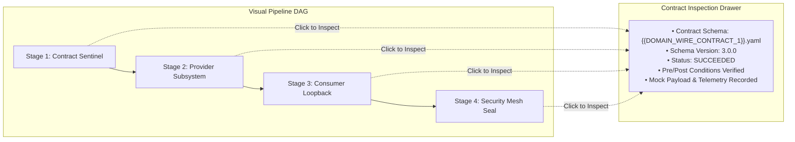

# Layerable Context Engineering Plan: {{DOMAIN_NAME}} Space

> **Standard Template Kit**: [`.nb/plan/templates/`](file:///Users/lakhwinder/PycharmProjects/nb_fairyfly/.nb/plan/templates/)  
> **Parent Master Framework**: [`.nb/plan/master/parent-master-plan/`](file:///Users/lakhwinder/PycharmProjects/nb_fairyfly/.nb/plan/master/parent-master-plan/)  
> **Automated Validation Suite**: [`bash .nb/plan/scripts/validate.sh`](file:///Users/lakhwinder/PycharmProjects/nb_fairyfly/.nb/plan/scripts/validate.sh)

---

### Executive Overview & Domain Grounding

This document is a standardized **Layerable Domain-Specific Context Engineering Plan Reference Guide** designed to demonstrate the unified synthesis of concise and detailed specifications over the generic **Parent Master Framework** (`.nb/plan/master/parent-master-plan/concise.md`).

While the parent master framework governs universal poly-module lifecycle orchestration, cryptographic Merkle state verification, AST token compression, and autonomous CI/CD, this domain layer injects domain-specific wire contracts, visual pipeline stages, contract inspection drawers, specialist subagents, re-entrant lifecycle hooks, and verification bridges required for:

1. **{{DOMAIN_CORE_CAPABILITY_1}}**: Description of core technology stack, target protocols, or runtimes.
2. **{{DOMAIN_CORE_CAPABILITY_2}}**: Description of domain data structures, state machines, or transactional boundaries.
3. **{{DOMAIN_CORE_CAPABILITY_3}}**: Description of security, compliance, or strict domain-level invariant constraints.
4. **{{DOMAIN_CORE_CAPABILITY_4}}**: Automated testing harnesses, visual pipeline DAG, and mock simulation loopback.

---

## 1. Autonomous Execution Engine & Swarm Authority Hierarchy

Autonomous agents executing this plan operate under the 4-tier Percipience authority tree:
`ORCHESTRATOR` > `DOMAIN_ARCHITECT` > `SPECIALIST_WORKER` > `GATEKEEPER_SENTINEL`

- **Dynamic DAG Schedular**: `DynamicDAGOrchestrator` schedules subagent waves using Kahn's topological sort.
- **Hermetic Worktrees**: Each specialist subagent leases an isolated ephemeral Git worktree (`wt_mod_{{PROVIDER_MODULE}}`, `wt_mod_{{CONSUMER_MODULE}}`).
- **Autonomous Lifecycle Hooks**:
  - `PreSpawnHook`: Leases worktree, validates CBAC capabilities, and allocates RAM scratchpad.
  - `PreExecutionHook`: Ingests AST-pruned context and verifies wire contract schemas.
  - `InFlightGuardrail`: Scans code diffs for prompt injection, secret leaks, and unvetted dependencies.
  - `HandoverHook`: Emits HMAC-SHA256 signed `HandoffToken` bound to artifact hash and $S_{SP} \ge 0.950$.
  - `PreMergeGateHook`: Executes the 7-Stage Pre-Merge Gatekeeper (`./percipience gate`).
  - `PostFailureHook`: Initiates bounded 3-step diagnostic self-healing loop (`crates/percipience-core/src/diagnostic.rs`).
  - `PostMergeSealHook`: Commits state to Merkle ledger and triggers immutable WORM cloud egress.

---

## 2. Visual Pipeline DAG & Contract Inspection Drawer Integration

Workflows execute as directed acyclic graphs visible in IDE plugins (IntelliJ/PyCharm, VSCode) and the SaaS Portal. Engineers and autonomous agents can inspect each stage to verify handled contracts:



### Stage Handled Contracts Specification

| Stage ID | Executor | Handled Contract | Preconditions & Postconditions |
| :--- | :--- | :--- | :--- |
| `stage_validate_contracts` | `agent_contract_sentinel` | `{{DOMAIN_WIRE_CONTRACT_1}}.yaml` | Pre: Schema files exist; Post: 100% schema conformance |
| `stage_build_provider` | `agent_{{SPECIALIST_AGENT_1}}` | `{{DOMAIN_WIRE_CONTRACT_2}}.json` | Pre: Clean worktree; Post: Provider compiles and passes tests |
| `stage_verify_consumer` | `agent_{{SPECIALIST_AGENT_2}}` | `{{DOMAIN_WIRE_CONTRACT_1}}.yaml` | Pre: Mock server active; Post: Consumer loopback 0 drifts |
| `stage_security_seal` | `platform.gatekeeper` | `security_mesh_attestation` | Pre: All stages pass; Post: Merkle block sealed ($S_{SP} \ge 0.950$) |

---

## 3. Cryptographic Inter-Agent Handover Protocol

Transitions between subagents require cryptographically attested `HandoffToken` payloads:

$$\text{Token} = \text{HMAC-SHA256}(K_{\text{platform}}, \text{WorkflowID} : \text{Stage} : \text{GateID} : \text{FromAgent} \to \text{ToAgent} : \text{ArtifactHash} : \text{ParityHash} : \text{Nonce})$$

- **Guaranteed Delivery**: Outbox spool (`.nb/context/handoffs/outbox/`) $\to$ Inbox spool (`.nb/context/handoffs/inbox/<recipient>/`).
- **Anti-Replay Defense**: Replay detected if `(token_hash, handoff_id)` already spent or age $> 300\text{s}$.
- **Hop Ceiling**: Hard clamp at $N \le 5$ hops to prevent recursive swarm explosion.
- **Anti-Drift Gating**: Handover blocked if semantic parity $S_{SP} < 0.950$.

---

## 4. 4-Pillar Error Taxonomy & Bounded Self-Repair SLA

| Error Pillar | Root Cause | Automated Playbook | Escalation & Recovery SLA |
| :--- | :--- | :--- | :--- |
| **TRANSIENT** | API timeout, rate limit, lock contention | Exponential jitter ($t_r = 2^r \cdot 500\text{ms}$) | Max 3 retries; fallback to local offline mode |
| **STRUCTURAL** | Syntax error, compilation break, type mismatch | Diagnostic reprompter with isolated AST diff | Bounded 3-step repair; if failed, revert step |
| **INVARIANT** | Contract schema deviation, breaking API change | Contract diff inspection, strict schema rejection | Freeze worktree; halt pipeline before merge |
| **HALLUCINATORY** | Invented API, circular logic, phantom package | Context purge, surgical rollback to $RP_k$ | Quarantine in `poisoning_quarantine.md` |

---

## 5. Domain-Specific Quad-Space Mapping

```
.
├── .nb/
│   ├── context/
│   │   ├── contracts/
│   │   │   ├── {{DOMAIN_WIRE_CONTRACT_1}}.yaml      # Primary inter-module communication wire contract
│   │   │   └── {{DOMAIN_WIRE_CONTRACT_2}}.json      # Domain event payloads or state schema validations
│   │   ├── rules/
│   │   │   ├── {{DOMAIN_INVARIANTS_RULE_1}}.md      # Domain architectural invariant rules
│   │   │   └── {{DOMAIN_INVARIANTS_RULE_2}}.md      # Memory, latency, or throughput bounds
│   │   └── handoffs/
│   │       ├── outbox/                               # Persistent spool for outgoing handoffs
│   │       └── inbox/                                # Recipient inboxes per specialist agent
│   └── agentic/
│       └── custom/
│           ├── agents/
│           │   ├── agent_{{SPECIALIST_AGENT_1}}.yaml # Domain producer/driver specialist subagent
│           │   └── agent_{{SPECIALIST_AGENT_2}}.yaml # Domain consumer/client specialist subagent
│           └── workflows/
│               └── {{DOMAIN_DELIVERY_WORKFLOW}}.yaml # Domain-specific verification and build pipeline DAG
├── workplace/
│   ├── modules/
│   │   ├── mod_{{PROVIDER_MODULE}}/                 # Core provider subsystem implementation
│   │   └── mod_{{CONSUMER_MODULE}}/                 # Consumer application or client implementation
│   └── tests/
│       └── test_{{DOMAIN_SLUG}}_space.py            # Unit & loopback integration tests
└── user/
    ├── inputs/
    │   └── {{DOMAIN_MVS_SPEC}}.yaml                 # Sparse initial user specification / requirements
    ├── outputs/
    │   └── {{DOMAIN_SLUG}}_receipt.json             # Verification receipts and artifacts
    └── hitl/
        └── poisoning_quarantine.md                  # Quarantine ledger for contract violations
```

---

## 6. Formal Wire Contracts & Safety Invariants

### 6.1. `.nb/context/contracts/{{DOMAIN_WIRE_CONTRACT_1}}.yaml`

```yaml
schema_version: "3.0.0"
domain: "{{DOMAIN_SLUG}}"
contract_type: "RPC_OR_REST_OR_STREAM"
service_endpoint: "/api/v1/{{DOMAIN_SLUG}}"
strict_mode: true
payload_schema:
  type: "object"
  required: ["header", "payload", "security_signature"]
  properties:
    header:
      type: "object"
      required: ["message_id", "timestamp", "source_module"]
      properties:
        message_id: { type: "string", format: "uuid" }
        timestamp: { type: "string", format: "date-time" }
        source_module: { type: "string" }
    payload:
      type: "object"
    security_signature:
      type: "object"
      required: ["token_id", "hmac_signature"]
      properties:
        token_id: { type: "string" }
        hmac_signature: { type: "string", pattern: "^[a-f0-9]{64}$" }
```

### 6.2. `.nb/context/rules/{{DOMAIN_INVARIANTS_RULE_1}}.md`

- **Domain Invariant 1 (Strict Schema Parity)**: All communication between producer and consumer must strictly conform to `.nb/context/contracts/`.
- **Domain Invariant 2 (HMAC-SHA256 Handoff Authentication)**: Every cross-module handoff must carry a valid cryptographic token.
- **Domain Invariant 3 (Zero AST Drift)**: Source code AST must strictly match interface specifications.
- **Domain Invariant 4 (Surgical Fault Isolation)**: Any detected contract drift triggers single-module rollback without impacting sibling modules.

---

## 7. Security Mesh, Surgical Rollback & Poisoning Defense

Under this domain plan, recovery points are strictly isolated per module:
- `RP_{{PROVIDER_PREFIX}}_001`: Verified clean state of provider module.
- `RP_{{CONSUMER_PREFIX}}_002`: Verified clean state of consumer module.

**Failure Mitigation**:
If an agent introduces an incompatible field or dependency breach in `mod_{{CONSUMER_MODULE}}`:
1. `PoisoningSentinel.execute_surgical_rollback` restores only `workplace/modules/mod_{{CONSUMER_MODULE}}/` to its last verified recovery point.
2. Sibling module `workplace/modules/mod_{{PROVIDER_MODULE}}/` remains untouched.
3. The invalid state is logged to `user/hitl/poisoning_quarantine.md`, and a new Merkle block is sealed.

---

## 8. Dynamic Commercial Tier Matrix

| Tier | Entitled Features | Module Scope | Packaging Output |
| :--- | :--- | :--- | :--- |
| **Free Community** (`plan_free`) | Gatekeeper checks, local AST pruning | Local provider module | Local repo only |
| **Team Tier** (`plan_team`) | + Ephemeral worktrees, custom agents | Provider + Consumer modules | Local + IDE plugins |
| **Business Tier** (`plan_business`) | + Sealed .nbpack packaging, visual pipeline drawer | All domain modules | Cloud SaaS + IDE plugins |
| **Enterprise Dedicated** (`plan_enterprise`) | + Swarm Triad, VPC enclave, WORM vault | Full repository + custom contracts | Dedicated multi-tenant cluster |

---

## 9. CLI Commands & Verification Protocol

```bash
# 1. Verify and synchronize plan versions
python3 .nb/plan/scripts/sync_plan_versions.py

# 2. Run automated validation suite (DAG, Schema v3.0, Hashes, Matrix)
bash .nb/plan/scripts/validate.sh

# 3. Package into sealed .nbpack envelope
./percipience layer pack \
  --plan .nb/plan/{{LAYER_LEVEL}}/{{DOMAIN_SLUG}}/concise.md \
  --output .nb/bundles/{{DOMAIN_SLUG}}_domain.nbpack

# 4. Run PR Gatekeeper verification
./percipience gate
```
