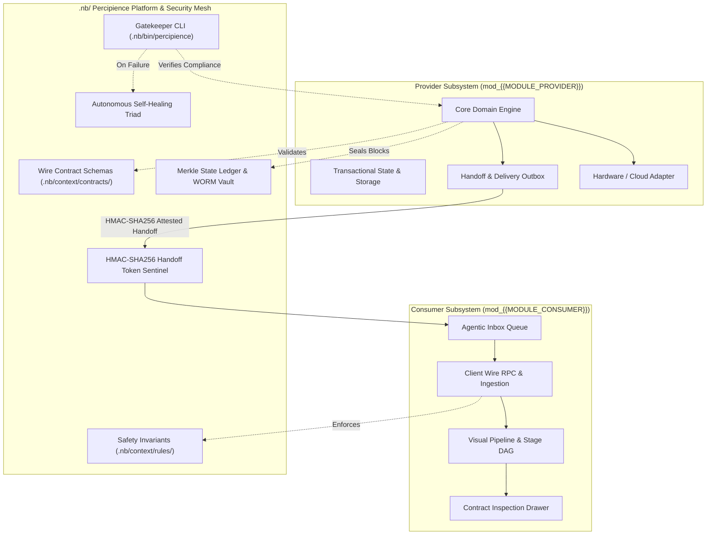
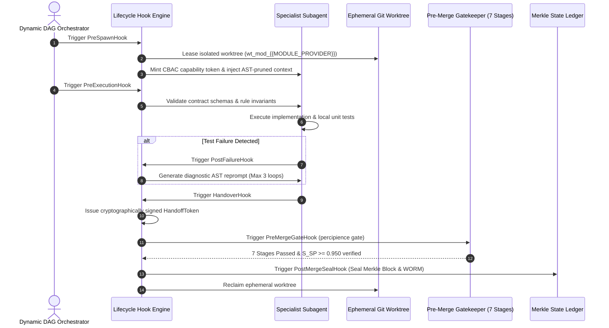
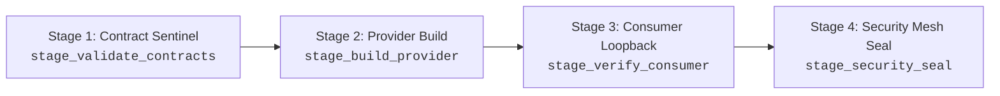

# Layerable Context Engineering Plan: {{DOMAIN_NAME}} (Detailed Blueprint)

### Executive Overview & Domain Grounding

This document is the **Comprehensive Implementation Blueprint** for the **{{DOMAIN_NAME}}** layerable domain space. It overlays onto the **Parent Master Framework** (`.nb/plan/master/parent-master-plan/detailed.md`), providing the definitive engineering reference for data schemas, wire contracts, specialist subagents, visual pipeline stages, contract inspection drawers, re-entrant lifecycle hooks, cryptographic handovers, security mesh boundaries, and verification test harnesses.

While the parent master framework enforces repository-wide poly-module orchestration, cryptographic Merkle state sealing, content-addressable AST token caching, and autonomous CI/CD verification, this domain layer injects concrete architectural patterns, interface specifications, wire contracts, specialist subagents, and test harnesses required for autonomous execution of the {{DOMAIN_NAME}} subsystem.

---

## 1. Subsystem Architecture & Domain Decomposition

The domain decomposes into cooperating subsystems operating across strict architectural boundaries:



### 1.1. Core Capabilities
1. **{{DOMAIN_CAPABILITY_1}}**: Encapsulates runtime protocols, serialization formats, and execution communication channels.
2. **{{DOMAIN_CAPABILITY_2}}**: Manages isolated state representations, idempotency keys, and transactional atomicity.
3. **{{DOMAIN_CAPABILITY_3}}**: Enforces non-negotiable memory, latency, and security bounds verified by automated sentinels.
4. **{{DOMAIN_CAPABILITY_4}}**: Provides hermetic virtual mocking and simulation loopbacks for deterministic CI/CD execution.

---

## 2. Autonomous Execution Engine & Re-Entrant Lifecycle Hooks

Autonomous agents executing this plan must operate under the 4-tier Percipience authority tree:
`ORCHESTRATOR` > `DOMAIN_ARCHITECT` > `SPECIALIST_WORKER` > `GATEKEEPER_SENTINEL`

### 2.1. Re-Entrant Hook Lifecycle Pipeline



### 2.2. Seven-Stage Pre-Merge Gatekeeper Lifecycle

Step `[5/7]` of `./.nb/bin/percipience gate` validates this domain plan through seven immutable stages:

1. **Stage 1 (AST Parse & Tokenization)**: Code passes Tree-Sitter AST syntax check with zero fatal syntax errors.
2. **Stage 2 (Wire Contract Conformance)**: Input/output payloads conform 100% to `.nb/context/contracts/`.
3. **Stage 3 (Fast Invariant Unit Tests)**: Unit tests execute and pass within standard developer timeout ceilings ($< 30\text{s}$).
4. **Stage 4 (Flaky Test Quarantine)**: Tests exhibiting variance $\ge 15\%$ across 3 runs quarantined to `flaky_quarantine.yaml`.
5. **Stage 5 (Regression & Red-Team Security)**: Full unit, integration, and security red-team suites pass (0 critical CVEs).
6. **Stage 6 (Living Documentation Sync)**: Code AST public interfaces match generated architecture models in `workplace/docs/`.
7. **Stage 7 (Anti-Drift Parity & Merkle Seal)**: Composite semantic parity $S_{SP} \ge 0.950$ verified; block sealed in `context_ledger.yaml`.

---

## 3. Cryptographic Inter-Agent Handover & HandoffToken Protocol

All cross-module and cross-agent communication is governed by cryptographically signed handoff tokens preventing unauthorized pipeline jumps, replay attacks, and state drift.

### 3.1. Mathematical Attestation Formula

$$\text{Token} = \text{HMAC-SHA256}(K_{\text{platform}}, \text{WorkflowID} : \text{Stage} : \text{GateID} : \text{FromAgent} \to \text{ToAgent} : \text{ArtifactHash} : \text{ParityHash} : \text{Nonce})$$

Where:
- $K_{\text{platform}}$: KMS-derived 256-bit enclave key stored in `.nb/context/kms_keyring.json`.
- $\text{ArtifactHash}$: SHA-256 digest of the transferred payload or generated code diff.
- $\text{ParityHash}$: SHA-256 digest of the 6-vector semantic parity report ($S_{SP} \ge 0.950$).
- $\text{Nonce}$: 128-bit single-use cryptographic token (`secrets.token_hex(16)`).

### 3.2. Formal Handoff Payload Schema (`inter_agent_handoff_contract.yaml`)

```json
{
  "$schema": "https://json-schema.org/draft/2020-12/schema",
  "title": "InterAgentHandoffPayload",
  "type": "object",
  "required": [
    "handoff_id", "workflow_id", "stage", "from_agent", "to_agent",
    "token_hash", "nonce", "artifact_hash", "parity_receipt_hash", "timestamp"
  ],
  "properties": {
    "handoff_id": { "type": "string", "pattern": "^ho_[a-zA-Z0-9_-]+$" },
    "workflow_id": { "type": "string" },
    "stage": { "type": "string" },
    "from_agent": { "type": "string" },
    "to_agent": { "type": "string" },
    "token_hash": { "type": "string", "pattern": "^[a-f0-9]{64}$" },
    "nonce": { "type": "string", "pattern": "^[a-f0-9]{32}$" },
    "artifact_hash": { "type": "string", "pattern": "^[a-f0-9]{64}$" },
    "parity_receipt_hash": { "type": "string", "pattern": "^[a-f0-9]{64}$" },
    "ttl_seconds": { "type": "integer", "default": 300 },
    "hop_count": { "type": "integer", "maximum": 5 },
    "lineage": { "type": "array", "items": { "type": "string" } },
    "timestamp": { "type": "string", "format": "date-time" }
  },
  "additionalProperties": false
}
```

### 3.3. Handover Delivery & Invariant Verification Engine

```python
# Location: workplace/modules/mod_{{MODULE_PROVIDER}}/handoff_client.py
import hmac
import hashlib
import json
import time
from pathlib import Path
from typing import Dict, Any, Tuple

class DomainHandoffClient:
    """Manages cryptographic handoffs between provider and consumer subagents."""

    @staticmethod
    def create_handoff_payload(
        secret: bytes,
        workflow_id: str,
        stage: str,
        gate_id: str,
        from_agent: str,
        to_agent: str,
        artifact_content: str,
        s_sp_score: float
    ) -> Dict[str, Any]:
        assert s_sp_score >= 0.950, f"Handover blocked: Anti-Drift score {s_sp_score} < 0.950"

        artifact_hash = hashlib.sha256(artifact_content.encode("utf-8")).hexdigest()
        parity_hash = hashlib.sha256(str(s_sp_score).encode("utf-8")).hexdigest()
        nonce = hashlib.sha256(str(time.time()).encode("utf-8")).hexdigest()[:32]

        msg = f"{workflow_id}:{stage}:{gate_id}:{from_agent}->{to_agent}:{artifact_hash}:{parity_hash}:{nonce}"
        token_hash = hmac.new(secret, msg.encode("utf-8"), hashlib.sha256).hexdigest()

        return {
            "handoff_id": f"ho_{nonce[:12]}",
            "workflow_id": workflow_id,
            "stage": stage,
            "from_agent": from_agent,
            "to_agent": to_agent,
            "token_hash": token_hash,
            "nonce": nonce,
            "artifact_hash": artifact_hash,
            "parity_receipt_hash": parity_hash,
            "ttl_seconds": 300,
            "timestamp": time.strftime("%Y-%m-%dT%H:%M:%SZ", time.gmtime())
        }
```

---

## 4. Visual Pipeline DAG & Contract Inspection Drawer Specifications

The execution pipeline is represented as an interactive DAG rendered across IDE plugins (IntelliJ/PyCharm, VSCode) and the SaaS Portal. Selecting any node opens the **Contract Inspection Drawer**, displaying wire contract schemas, handled contracts, inputs, outputs, and live validation status.

### 4.1. Stage-to-Contract Mapping Specification



### 4.2. Stage Handled Contracts Table

| Stage Identifier | Stage Name | Handled Contract ID | Preconditions | Postconditions | Failure Recovery Playbook |
| :--- | :--- | :--- | :--- | :--- | :--- |
| `stage_validate_contracts` | Schema & Invariant Sentinel | `{{DOMAIN_WIRE_CONTRACT_1}}.yaml` | Schema files exist in `.nb/context/contracts/` | All schemas valid YAML/JSON; strict linter passes | Abort pipeline; emit schema error trace |
| `stage_build_provider` | Provider Subsystem Build | `{{DOMAIN_WIRE_CONTRACT_2}}.json` | Contract validation passed; clean git worktree | Binary / module compiled; unit tests passing | Restore provider worktree to last clean recovery point ($RP_k$) |
| `stage_verify_consumer` | Consumer Loopback Test | `{{DOMAIN_WIRE_CONTRACT_1}}.yaml` | Provider artifact built; mock server active | E2E loopback test passing; 0 contract drifts | Isolate consumer module; log to poisoning quarantine |
| `stage_security_seal` | Security Mesh Gatekeeper | `handoff_token_attestation` | All upstream stages PASSED | Merkle block sealed; Ed25519 receipt generated | Reject PR / commit; quarantine untrusted diffs |

### 4.3. Contract Inspection Drawer UI & Data Specification

```json
{
  "$schema": "https://json-schema.org/draft/2020-12/schema",
  "title": "StageContractInspectionRecord",
  "type": "object",
  "required": ["stage_id", "status", "handled_contract", "inputs", "outputs", "telemetry"],
  "properties": {
    "stage_id": { "type": "string" },
    "status": { "type": "string", "enum": ["PENDING", "RUNNING", "SUCCEEDED", "FAILED", "BLOCKED"] },
    "handled_contract": {
      "type": "object",
      "required": ["contract_id", "schema_path", "schema_version", "strict_mode"],
      "properties": {
        "contract_id": { "type": "string" },
        "schema_path": { "type": "string" },
        "schema_version": { "type": "string" },
        "strict_mode": { "type": "boolean" },
        "mock_payload": { "type": "object" }
      }
    },
    "inputs": { "type": "object" },
    "outputs": { "type": "object" },
    "telemetry": {
      "type": "object",
      "properties": {
        "duration_ms": { "type": "integer" },
        "tokens_consumed": { "type": "integer" },
        "cache_hit_rate": { "type": "number" }
      }
    }
  }
}
```

---

## 5. Domain-Specific Quad-Space Physical Mapping

```
.
├── .nb/
│   ├── context/
│   │   ├── contracts/
│   │   │   ├── {{DOMAIN_WIRE_CONTRACT_1}}.yaml      # Primary payload wire contract schema
│   │   │   └── {{DOMAIN_WIRE_CONTRACT_2}}.json      # Telemetry / state transition schema
│   │   ├── rules/
│   │   │   ├── {{DOMAIN_INVARIANT_RULE_1}}.md       # Architectural boundaries & threading invariants
│   │   │   └── {{DOMAIN_INVARIANT_RULE_2}}.md       # Latency, memory & security guardrails
│   │   └── handoffs/
│   │       ├── outbox/                               # Persistent spool for outgoing handoffs
│   │       └── inbox/                                # Recipient inboxes per specialist agent
│   └── agentic/
│       └── custom/
│           ├── agents/
│           │   ├── agent_{{SPECIALIST_AGENT_1}}.yaml # Provider / backend engineering specialist
│           │   └── agent_{{SPECIALIST_AGENT_2}}.yaml # Consumer / client integration specialist
│           └── workflows/
│               └── {{DELIVERY_WORKFLOW}}.yaml        # End-to-end delivery & verification DAG
├── workplace/
│   ├── modules/
│   │   ├── mod_{{MODULE_PROVIDER}}/                  # Provider implementation codebase
│   │   └── mod_{{MODULE_CONSUMER}}/                  # Consumer implementation codebase
│   └── tests/
│       └── test_{{DOMAIN_SLUG}}_space.py             # 100% coverage domain integration test suite
└── user/
    ├── inputs/
    │   └── {{DOMAIN_SLUG}}_spec.yaml                 # Sparse initial specification input
    ├── outputs/
    │   └── {{DOMAIN_SLUG}}_verification_report.md    # Gatekeeper verification receipt
    └── hitl/
        └── poisoning_quarantine.md                   # Quarantine ledger for contract violations
```

---

## 6. Formal Wire Contracts, Boundary Invariants & Data Schemas

### 6.1. Contract: `.nb/context/contracts/{{DOMAIN_WIRE_CONTRACT_1}}.yaml`

```yaml
schema_version: "3.0.0"
domain: "{{DOMAIN_SLUG}}"
contract_type: "EVENT_STREAM_OR_RPC"
strict_mode: true
payload_schema:
  type: "object"
  required:
    - "header"
    - "payload"
    - "security_signature"
  properties:
    header:
      type: "object"
      required: ["message_id", "timestamp", "source_module", "schema_version"]
      properties:
        message_id: { type: "string", format: "uuid" }
        timestamp: { type: "string", format: "date-time" }
        source_module: { type: "string" }
        schema_version: { type: "string", const: "3.0.0" }
    payload:
      type: "object"
      required: ["action", "parameters"]
      properties:
        action: { type: "string" }
        parameters: { type: "object" }
    security_signature:
      type: "object"
      required: ["token_id", "hmac_signature", "signer_identity"]
      properties:
        token_id: { type: "string" }
        hmac_signature: { type: "string", pattern: "^[a-f0-9]{64}$" }
        signer_identity: { type: "string" }
```

### 6.2. Safety Rules: `.nb/context/rules/{{DOMAIN_INVARIANT_RULE_1}}.md`

- **Rule 1 (Zero Unchecked Jumps)**: All transitions between provider and consumer must be mediated by verified handoff tokens issued by `HandoffValidator`.
- **Rule 2 (Deterministic Execution)**: Network sockets, hardware interfaces, and external clocks must use mockable abstraction layers during test execution.
- **Rule 3 (Content-Addressable Token Conservation)**: AST skeletons must be maintained to achieve $\ge 60\%$ prompt token reduction when ingested by AI agents.
- **Rule 4 (Surgical Rollback Isolation)**: Any failure in `mod_{{MODULE_CONSUMER}}` must trigger module-level rollback without touching `mod_{{MODULE_PROVIDER}}`.

---

## 7. Specialist Subagents & Handled Contract Workflow DAG

### 7.1. Specialist Agent: `agent_{{SPECIALIST_AGENT_1}}`

```yaml
agent_id: "agent_{{SPECIALIST_AGENT_1}}"
name: "{{DOMAIN_NAME}} Provider Specialist"
category: "domain_provider_engineering"
model_profile:
  model: "claude-3-7-sonnet-20250219"
  role: "Provider Engine, Wire Protocol & Low-Level Systems Specialist"
  context_budget_tokens: 16000
isolation_and_sandboxing:
  worktree_isolation: true
  default_ttl_seconds: 300
module_scope:
  allowed_modules:
    - "workplace/modules/mod_{{MODULE_PROVIDER}}"
    - ".nb/context/contracts"
capabilities:
  - "CAP_FS_READ"
  - "CAP_FS_WRITE_MODULE_ONLY"
  - "CAP_EXEC_SUBPROCESS"
```

### 7.2. Specialist Agent: `agent_{{SPECIALIST_AGENT_2}}`

```yaml
agent_id: "agent_{{SPECIALIST_AGENT_2}}"
name: "{{DOMAIN_NAME}} Consumer Specialist"
category: "domain_consumer_engineering"
model_profile:
  model: "claude-3-5-haiku-20241022"
  role: "Client SDK, Application Layer & Gateway Specialist"
  context_budget_tokens: 12000
isolation_and_sandboxing:
  worktree_isolation: true
  default_ttl_seconds: 300
module_scope:
  allowed_modules:
    - "workplace/modules/mod_{{MODULE_CONSUMER}}"
    - ".nb/context/contracts"
capabilities:
  - "CAP_FS_READ"
  - "CAP_FS_WRITE_MODULE_ONLY"
```

### 7.3. Delivery Workflow Manifest: `{{DELIVERY_WORKFLOW}}.yaml`

```yaml
workflow_id: "{{DELIVERY_WORKFLOW}}"
name: "{{DOMAIN_NAME}} End-to-End Delivery Flow"
version: "1.0.0"
stages:
  - id: "stage_validate_contracts"
    name: "Validate Wire Contracts & Invariants"
    executor: "agent_contract_sentinel"
    timeout_ms: 5000
    handled_contracts:
      - contract_id: "{{DOMAIN_WIRE_CONTRACT_1}}"
        schema_path: ".nb/context/contracts/{{DOMAIN_WIRE_CONTRACT_1}}.yaml"
        strict_validation: true

  - id: "stage_build_provider"
    name: "Compile & Verify Provider Subsystem"
    executor: "agent_{{SPECIALIST_AGENT_1}}"
    depends_on: ["stage_validate_contracts"]
    timeout_ms: 15000
    handled_contracts:
      - contract_id: "{{DOMAIN_WIRE_CONTRACT_2}}"
        schema_path: ".nb/context/contracts/{{DOMAIN_WIRE_CONTRACT_2}}.json"
        strict_validation: true

  - id: "stage_verify_consumer"
    name: "Execute Consumer Loopback & Integration Tests"
    executor: "agent_{{SPECIALIST_AGENT_2}}"
    depends_on: ["stage_build_provider"]
    timeout_ms: 15000
    handled_contracts:
      - contract_id: "{{DOMAIN_WIRE_CONTRACT_1}}"
        schema_path: ".nb/context/contracts/{{DOMAIN_WIRE_CONTRACT_1}}.yaml"
        strict_validation: true

  - id: "stage_security_seal"
    name: "Run Percipience PR Gatekeeper & Seal Merkle Block"
    executor: "platform.gatekeeper"
    depends_on: ["stage_verify_consumer"]
    timeout_ms: 20000
    handled_contracts:
      - contract_id: "security_mesh_attestation"
        schema_path: ".nb/context/contracts/security_mesh_attestation.yaml"
        strict_validation: true
```

---

## 8. Security Mesh, Sandboxing & Surgical Rollback

### 8.1. ReBAC Multi-Tenant Permission Check

```python
# Location: workplace/core/security_mesh_engine.py
def verify_domain_access(mesh, tenant_id: str, action: str, resource_id: str, actor_id: str) -> bool:
    """Verifies Zanzibar ReBAC permission tuple across tenant boundary."""
    return mesh.check_rebac_relation(
        tenant_id=tenant_id,
        entity_type="domain_module",
        entity_id=resource_id,
        relation=action,
        subject_type="agent",
        subject_id=actor_id
    )
```

### 8.2. Surgical Rollback & Poisoning Defense Playbook

If a subagent hallucination or contract drift is detected during stage verification:
1. `PoisoningSentinel` intercepts the faulty operation before git commit.
2. The faulty module (e.g. `workplace/modules/mod_{{MODULE_CONSUMER}}/`) is surgically rolled back to its prior verified recovery point (`RP_CONSUMER_k`).
3. Sibling modules (`workplace/modules/mod_{{MODULE_PROVIDER}}/`) remain active and unaffected.
4. The violation record, diff, and prompt trace are appended to `user/hitl/poisoning_quarantine.md`.

---

## 9. Autonomous Self-Healing & Diagnostic Reprompting Triad

When an invariant or test assertion fails, the orchestrator triggers `DiagnosticRePromptEngine` to initiate a bounded self-repair cycle:

1. **Failure Log Extraction**: Filters stack trace to isolate AST failure points (70–88% token reduction).
2. **Surgical Patch Synthesis**: Emits an AST patch focused strictly on the failing block.
3. **Bounded Iteration SLA**: Maximum 3 self-repair attempts before escalating to rollback or human quarantine.

---

## 10. 6-Vector Semantic Parity Audit Formulation

The domain must fulfill the **6-Vector Semantic Parity Gate** before PR integration:

$$S_{SP} = 0.20 S_{\text{AST}} + 0.25 S_{\text{Contract}} + 0.20 S_{\text{Behavior}} + 0.15 S_{\text{Handover}} + 0.10 S_{\text{Doc}} + 0.10 S_{\text{SupplyChain}} \ge 0.950$$

| Vector | Target | Verification Method |
| :--- | :---: | :--- |
| **AST Parity** | $\ge 0.98$ | Tree-Sitter public symbol and interface signature congruence. |
| **Contract Parity** | $\ge 0.98$ | Strict JSON Schema and OpenAPI validation across wire boundaries. |
| **Behavior Parity** | $\ge 0.98$ | Unit and integration test pass rate ($\frac{N_{\text{passed}}}{N_{\text{total}}} = 1.00$). |
| **Handover Parity** | $\ge 0.98$ | HMAC-SHA256 token signature and nonce verification. |
| **Doc Parity** | $\ge 0.98$ | Zero drift between `concise.md`, `detailed.md`, and code implementation. |
| **Supply Chain Parity** | $\ge 0.99$ | SHA-256 content hashes, lockfile integrity, and zero high/critical CVEs. |

---

## 11. Integration Testing Harness & Verification Suite

```python
# Location: workplace/tests/test_{{DOMAIN_SLUG}}_space.py
import pytest
from pathlib import Path

def test_wire_contract_conformance():
    """Verifies that domain payloads strictly conform to schemas."""
    schema_path = Path(".nb/context/contracts/{{DOMAIN_WIRE_CONTRACT_1}}.yaml")
    assert schema_path.exists(), "Wire contract 1 schema file missing"

def test_cross_module_handoff_isolation():
    """Verifies that handoff tokens prevent unauthorized DAG jumps."""
    schema_path = Path(".nb/context/contracts/{{DOMAIN_WIRE_CONTRACT_2}}.json")
    assert schema_path.exists(), "Wire contract 2 schema file missing"

def test_stage_handled_contracts():
    """Verifies that all workflow stages declare and handle contracts."""
    workflow_path = Path(".nb/agentic/custom/workflows/{{DELIVERY_WORKFLOW}}.yaml")
    assert workflow_path.exists(), "Delivery workflow DAG missing"

def test_surgical_rollback_isolation():
    """Verifies that poisoning quarantine ledger is present."""
    quarantine_path = Path("user/hitl/poisoning_quarantine.md")
    assert quarantine_path.parent.exists(), "Quarantine directory missing"
```

---

## 12. FinOps Telemetry, Model Tiering & Commercial Matrix

| Commercial Tier | Permitted Features | Module Scope | Packaging Output |
| :--- | :--- | :--- | :--- |
| **Free Community** (`plan_free`) | Standard AST pruner, basic gatekeeper verification | `mod_{{MODULE_PROVIDER}}` (read/test) | Local CLI only |
| **Team Tier** (`plan_team`) | Ephemeral Git worktrees, custom agent tasks, handoff validation | `mod_{{MODULE_PROVIDER}}`, `mod_{{MODULE_CONSUMER}}` | Local CLI + IDE plugins |
| **Business Tier** (`plan_business`) | Encrypted `.nbpack` domain layers, interactive visual pipeline drawer | All domain modules + packaging tools | Cloud SaaS + Multi-IDE |
| **Enterprise Dedicated** (`plan_enterprise`) | Dedicated Swarm governor, WORM egress vault, air-gapped VPC | Full repository + custom contracts | Dedicated multi-tenant cluster |

---

## 13. Implementation Roadmap & Phased Execution Waves

1. **Wave 1: Wire Contracts & Safety Invariants**: Author and freeze `{{DOMAIN_WIRE_CONTRACT_1}}.yaml`, `{{DOMAIN_WIRE_CONTRACT_2}}.json`, and invariant rules.
2. **Wave 2: Provider Subsystem Scaffolding**: Implement provider engine in `workplace/modules/mod_{{MODULE_PROVIDER}}/` with hermetic unit tests.
3. **Wave 3: Consumer Subsystem & Client RPC**: Implement consumer SDK in `workplace/modules/mod_{{MODULE_CONSUMER}}/` with mock loopbacks.
4. **Wave 4: Visual Pipeline DAG & Handled Contracts**: Author `{{DELIVERY_WORKFLOW}}.yaml` with explicit `handled_contracts` per stage and wire into IDE/Portal drawers.
5. **Wave 5: Security Mesh, Handoff Tokens & Gatekeeper**: Implement HMAC-SHA256 token validation, surgical rollback sentinels, and pre-commit gatekeeper integration.
6. **Wave 6: Packaging, Distribution & Sealed NBPack**: Package sealed `.nbpack` domain layer, verify cryptographic hashes via `sync_plan_versions.py`, and pass `validate.sh`.
