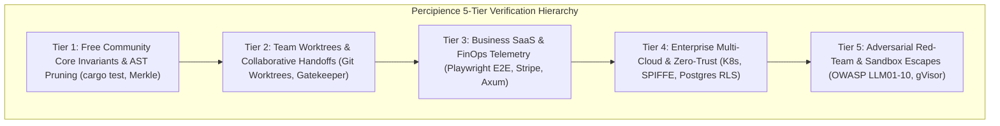

# ⚡ Percipience Master Test Plan (Concise Specification)

> **Purpose**: High-density testing specification optimized for rapid AI context ingestion, autonomous CI/CD gatekeeper integration, multi-tier capability regression, and adversarial vulnerability defense.

---

## 1. Multi-Tier Capability & Test Hierarchy



### Commercial Tier Capability Scope
- **Free Community**: CLI single-seat, Tree-Sitter AST pruner (60–85%), SHA-256 Merkle ledger, local self-repair loop, embedded IDE bootstrap.
- **Team**: + Multi-agent git worktree isolation, automated PR gatekeeper bot, VSCode extension integration, shared state sync.
- **Business**: + SaaS portal (Playwright E2E), JetBrains / PyCharm plugin, metering & Stripe webhooks, FinOps token savings rev-share ledger.
- **Enterprise**: + Multi-cloud K8s substrate, SPIFFE/SPIRE zero-trust mTLS, Zanzibar ReBAC & PostgreSQL RLS, WORM cloud egress, microVM/gVisor sandboxing.

---

## 2. Core Subsystem & Test Suite Catalog

```text
crates/
├── percipience-core/tests/           ← Invariants, AST Pruner, Merkle State & Token Compression
├── percipience-cli/tests/            ← Single Binary Commands, NPX Bootstrap & Subcommands
├── percipience-orchestrator/tests/   ← Dynamic DAG, Kahn Acyclicity & Wave Dispatch
├── percipience-security/tests/       ← OWASP LLM01-10 Red Team, FPE Vault & Cedar Guardrails
├── percipience-server/tests/         ← Axum HTTP, Connect-RPC, Telemetry & WebSocket Feeds
├── percipience-lsp/tests/            ← LSP 3.17 Protocol, AST Skeletons & IDE Diagnostics
└── percipience-packager/tests/       ← Tier Compilation Matrix, Ed25519 & Artifact Sealer
benches/
└── benchmarks.rs                     ← Criterion High-Throughput AST & Merkle Hashing Benchmarks
```

---

## 3. Dedicated Vulnerability & Security Red-Team Matrix

| Attack Category | Attack Vector | Target Subsystem | Verification Assertion |
| :--- | :--- | :--- | :--- |
| **LLM01 / LLM02** | Direct/Indirect Injection & AST Shell Escapes | Prompt Guard / Gatekeeper | NeMo guardrail blocks override; AST static analyzer rejects `eval`/`os.system` |
| **LLM03 / LLM04** | Context Poisoning & Billion Laughs DoS | Merkle Engine / Tree-Sitter | Merkle hash mismatch triggers quarantine; AST recursion bomb clamped $<500\text{ms}$ |
| **LLM05 / LLM06** | Supply Chain Hijack & PII/Secret Leak | Dependency Sentinel / FPE Vault | Typosquatted packages blocked; FPE masks keys with `[REDACTED_FPE_TOKEN]` |
| **LLM07 / LLM08** | Insecure Tools & Excessive Agency | ReBAC Authorization Broker | Unauthorized cloud/tool calls rejected with `PolicyAuthorizationError` |
| **Crypto Attack** | `HandoffToken` Forgery & Replay | Swarm Handoff Validator | Invalid HMAC signature or timestamp $>300\text{s}$ drops rogue agent session |
| **Crypto Attack** | Merkle State Collision / Prefix Attack | Merkle State Ledger | Sibling hash mismatch rejects counterfeit block |
| **Sandbox Breakout** | gVisor / microVM Kernel Exploits | Container Plan Executor | Syscalls blocked by `runsc` profile; returns `EPERM` |
| **Tenant Bleed** | PostgreSQL RLS Forged Header Bypass | SaaS Customer Portal | Cross-tenant queries return 0 rows; zero tenant cross-contamination |
| **Audit Tamper** | WORM S3/GCS Object Lock Overwrite | WORM Egress Manager | Storage backend returns `AccessDenied (ObjectLocked)`; audit preserved |

---

## 4. AI-Assisted Test Automation Protocol

1. **Autonomous Invocation**:
   ```bash
   cargo test --workspace
   ./percipience test --tier all --report json,html
   ```
2. **AI Failure Diagnosis & Self-Repair SLA**:
   - On test failure, `./percipience test --ai-triage` invokes `crates/percipience-core/src/diagnostic.rs`.
   - Synthesizes isolated AST failure diffs (70–88% token reduction, zero conversational noise).
   - Maximum 3 self-healing retry iterations before falling back to surgical rollback ($RP_k$).

---

## 5. Quality Gates & Acceptance Criteria

| Gate Metric | Target Threshold | Verification Mechanism |
| :--- | :---: | :--- |
| **Unit & Integration Pass Rate** | **100% (Zero Failures)** | `cargo test --workspace` |
| **Vulnerability Flaws** | **0 High / 0 Critical CVEs** | `cargo test -p percipience-security --test test_vulnerability_suite` |
| **6-Vector Semantic Parity** | **$S_{SP} \ge 0.950$** | `./percipience drift check` |
| **AST Token Compression Ratio** | **$60.0\% - 85.0\%$** | `TokenTracker.get_summary()` |
| **AST Pruning Latency** | **$\le 120\text{ms}$** | `TreeSitterDaemon.prune()` |
| **Web Accessibility Standard** | **WCAG 2.1 AA (0 Violations)** | `axe_accessibility_test.ts` |
| **Documentation & Link Integrity** | **100% Valid (0 Broken URIs)**| `link_checker_script.sh` |
| **LLM Faithfulness & Hallucination** | **$\ge 0.90$ Faithfulness, $\ge 0.95$ Hallucination-Free** | `EvalScoringEngine` |
| **Merkle State Chain Integrity** | **Cryptographically Valid** | `MerkleEngine.verify_chain()` |

---
*Certified for CI Gatekeeper Execution via `percipience gate` Step 5/7.*
